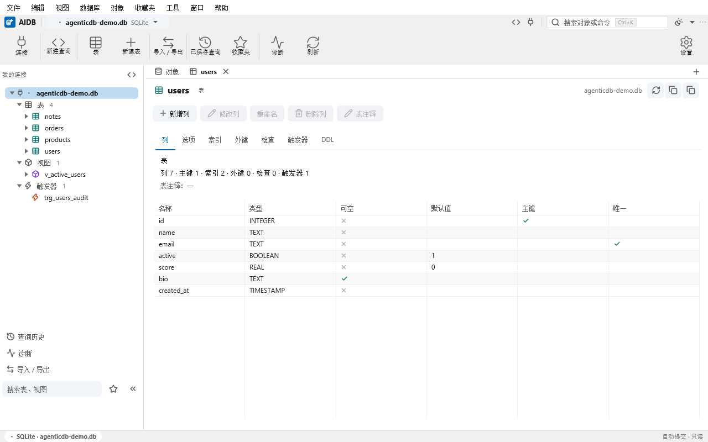
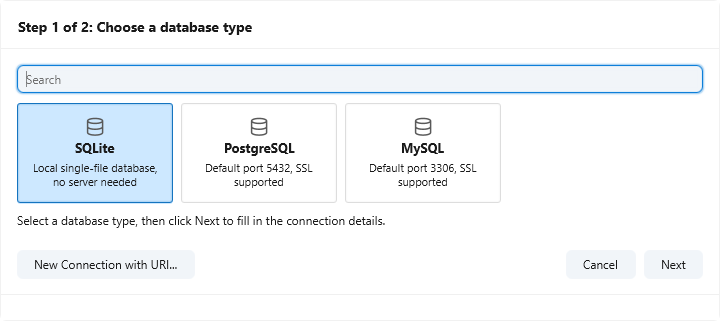
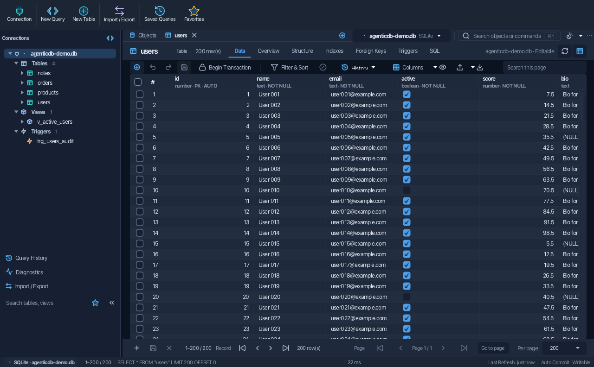
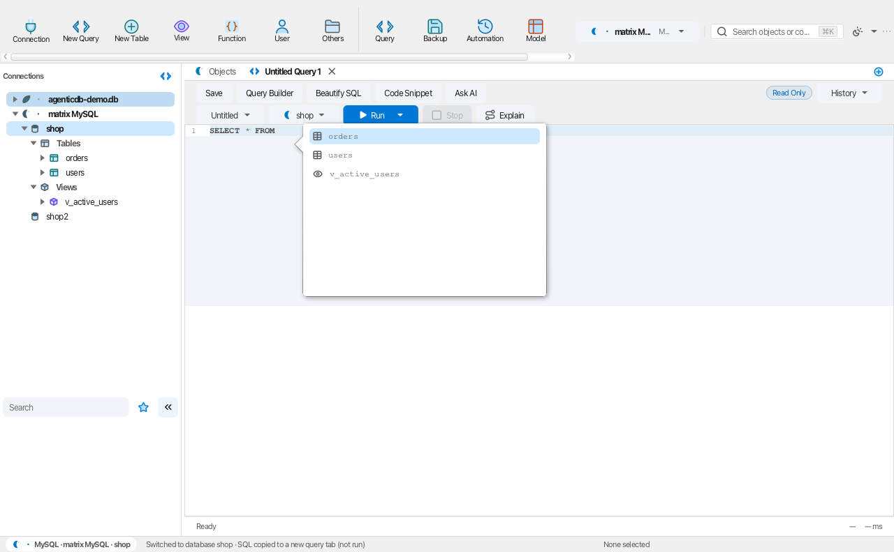
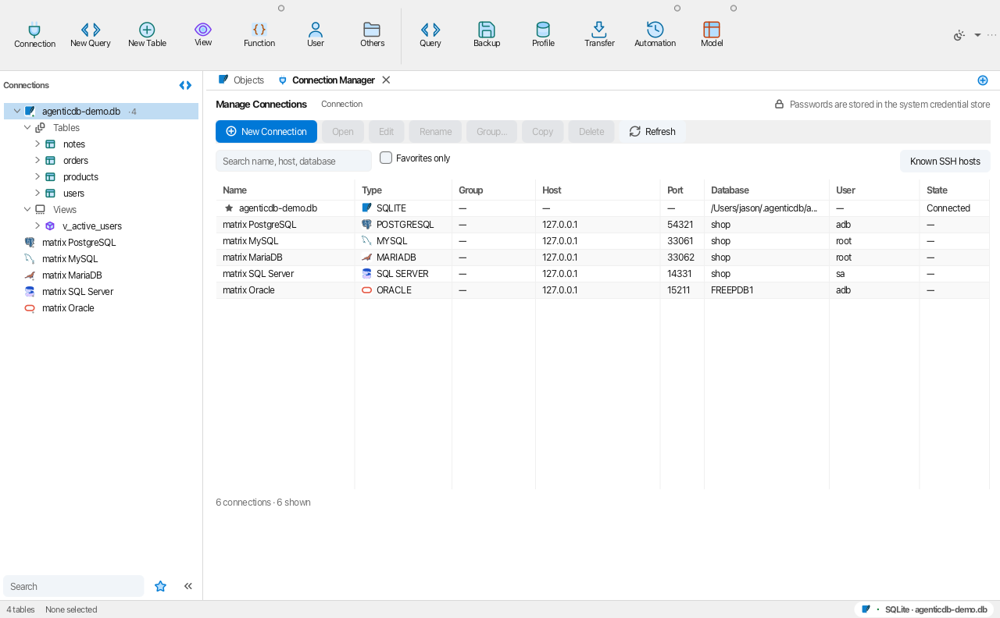
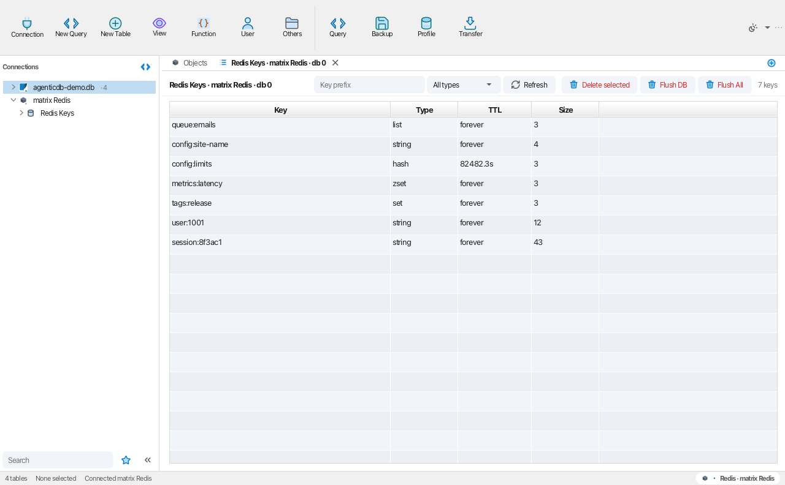
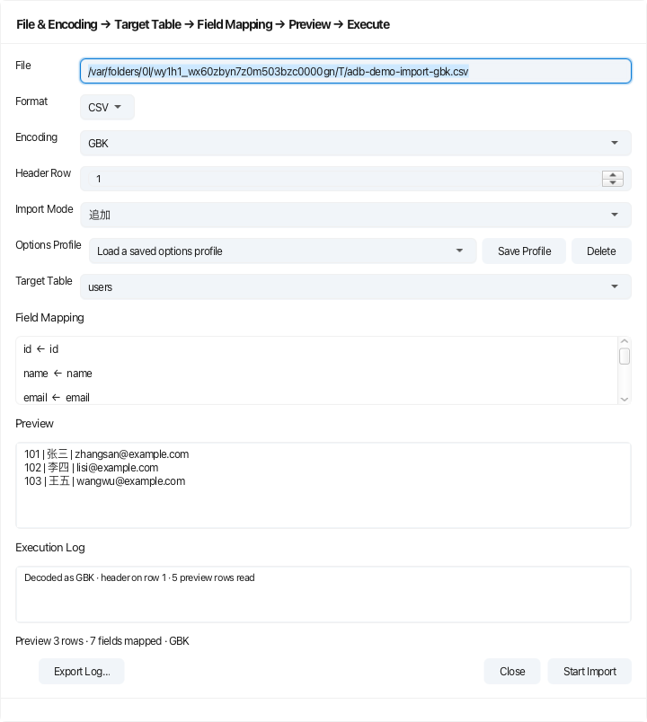

# AIDB — a native desktop database client

**Java 25 + JavaFX 25. No Electron, no embedded WebView, no local HTTP server.**  
One process, one window, every byte to your database over JDBC — and nothing else.

[](LICENSE)
[](https://github.com/jasonchow233-pixel/aidb/actions/workflows/ci.yml)


<p align="center">
  
</p>

---

## English

### Who it's for

You live in a database all day and want the window in front of you to behave like a desktop application: keyboard-reachable everything, no browser engine holding hundreds of megabytes, no localhost port a firewall or auditor must bless, and no telemetry — apart from the JDBC connection you configured, this app contains no network code.

If you want ER diagrams, notebooks, or an AI copilot, use DBeaver or Chat2DB. This project deliberately does not do those things.

### Databases

| Database | Status |
|---|---|
| **SQLite** | ✅ Supported — file-based, plus a bundled demo database |
| **MySQL** | ✅ 8.x — confirmed against a real server (8.4). 5.7 is dialect-level only |
| **PostgreSQL** | ✅ Confirmed against a real server (16) |
| **MariaDB** | ✅ 10.x / 11.x — confirmed against a real server |
| **SQL Server** | ✅ 2019+ — confirmed against a real server |
| **Oracle** | ✅ 12c+ — confirmed against a real server |
| **Redis** | ✅ Key browsing, five value types, TTL, DEL/FLUSHDB/FLUSHALL; Redis over SSH via a pure-Java tunnel |
| **Object storage** | ✅ One browser for S3-compatible (AWS S3, MinIO, LocalStack), Alibaba Cloud OSS, Qiniu Kodo, Tencent Cloud COS |

### What it looks like to use

<table>
  <tr>
    <td width="50%"><br><b>Edit data in place.</b> Server-side paging, inline Filter & Sort builder, value pickers, up to 3-level sorting, frozen columns, rectangle selection, undo/redo.</td>
    <td width="50%"><br><b>Write SQL, not mouse strokes.</b> Highlighted editor with line numbers, run current statement or all, cancel a running query, multi-statement result tabs, execution plan, error locator.</td>
  </tr>
  <tr>
    <td width="50%"><br><b>Change structure safely.</b> Add/alter/rename/drop columns, indexes, foreign keys, triggers, CHECK constraints — preview SQL before execution.</td>
    <td width="50%"><br><b>See the statement before it runs.</b> Every write dialog shows the exact SQL it is about to execute.</td>
  </tr>
  <tr>
    <td width="50%"><br><b>Connection wizard.</b> Six driver tiles with official vendor marks, SSL and SSH pages.</td>
    <td width="50%"><br><b>Object storage.</b> S3-compatible, OSS, Kodo, COS — prefix navigation, upload/download, presigned URLs.</td>
  </tr>
</table>

<details>
  <summary>More screenshots</summary>
  <p align="center">
     
     
    <br>
     
     
    
  </p>
  <p>Dark theme, cell inspector, SQL autocompletion, multi-vendor connections, Redis browser, import/export wizards, and more.</p>
</details>

### Install

**There are no signed, notarized binaries yet.** CI builds unsigned installers on every `v*` tag (`.dmg` / `.msi` / `.deb` via `jpackage`, attached to a draft release). Windows and Linux run unsigned packages without complaint; macOS Gatekeeper blocks an unsigned `.dmg`, so for macOS the supported path is a source build until notarization is wired up.

To run from source:

```bash
git clone https://github.com/jasonchow233-pixel/aidb.git
cd aidb
./scripts/dev.sh          # builds and launches — JDK 25–27, no Maven install needed
```

The first launch creates a demo database (`~/.agenticdb/agenticdb-demo.db`) so there is something real to click on before you point it at your own data. `./scripts/package.sh` produces a `jpackage` app-image / `.dmg` / `.msi` / `.deb` for your platform — it works, it is just unsigned.

**Fat jar (direct run):** `./mvnw -Pfat-jar -pl bootstrap/adb-desktop -am package -DskipTests` produces `target/adb-desktop-1.0.0-SNAPSHOT-fat.jar` (~101 MB, all dependencies bundled). Run with `java -jar adb-desktop-1.0.0-SNAPSHOT-fat.jar`.

### Feature highlights

- **Write safety, three layers.** Every SQL statement is classified by danger before it runs (fail-closed). Write operations preview the exact SQL and require confirmation; the driver re-checks the declared danger level and refuses under-declared danger. A save preview offers one-click undo.
- **Credentials never touch disk.** Passwords go to the OS secure store — macOS Keychain, Windows Credential Manager, Linux Secret Service — and fall back to process memory with a loud warning. `connections.json` keeps non-sensitive fields only.
- **Native desktop, no browser.** JavaFX 25 rendering, no embedded WebView, no local HTTP server, no Electron. One process, one window.
- **Design-token theming.** Light and dark themes, four density levels, 111 design tokens as a single source of truth — a theme switch needs no second icon set.
- **Keyboard-first.** ⌘K / Ctrl+K opens a command palette over every action. Menus, ribbon, toolbar, context menus and the palette are views onto one action registry.

### Why AIDB

| | Stack | Shape | What AIDB does differently |
|---|---|---|---|
| **DBeaver** | Java on Eclipse RCP | Desktop + web | Same language, different premise: one native toolkit, one token system, one action registry — no plugin graph, no driver downloader, no perspectives to learn. |
| **Beekeeper Studio** | Electron / React | Desktop | Modern UI, but a Chromium window. AIDB renders with JavaFX: no bundled browser, no renderer process per window. |
| **Navicat** | Native | Proprietary desktop | Object tree → double-click → data page → edit → save, entirely by keyboard — as a free, auditable Apache-2.0 codebase. |

### Safety model

1. **Classify first, fail closed.** Every statement is graded by danger before it runs. If the grader cannot tell what a statement does, it is treated as dangerous — the default is caution.
2. **Preview and confirm before writing.** Structure edits, routine rebuilds, restores and table transfers show the SQL before execution. DDL transaction support varies by engine; failures can leave partial changes.
3. **Driver-side second opinion.** `DbSession.execute(String, Danger)` re-classifies the statement and refuses under-declared danger — so even programmatic paths that skip UI confirmation are caught.

### Keyboard & accessibility

⌘K / Ctrl+K opens a command palette over every action. Menus, ribbon, toolbar, context menus and the palette are views onto one action registry, so an action disabled in one place is disabled in all of them. Focus walks the shell zones in a documented order, and each page carries a name a screen reader can read aloud.

### Development

```bash
./scripts/build.sh   # compile + full test suite + test-count floor — this is what CI runs
./scripts/dev.sh     # build and launch
./scripts/shots.sh   # regenerate screenshots from current code
./scripts/package.sh # jpackage bundle for the current platform
```

Maven is vendored (`./mvnw`), so there is nothing to install beyond a JDK. Full test baseline: **2153 executed / 0 failed / 133 skipped / 235 test classes**, 16/16 modules (JDK 25, macOS, 2026-11-24).

### Known limits, stated plainly

- **Cold start** historically **5.0–5.6 s** (2026-11-04, macOS, JDK 25, process start → first paint) against a <2 s goal. Lazy connection is WIP; the current startup path has not been re-benchmarked for acceptance.
- **No signed binaries.** Unsigned installers exist; macOS Gatekeeper blocks them. Use a source build on macOS until notarization is available.
- **No auto-update, no jlink runtime image** (RichTextFX / ControlsFX ship as automatic modules).
- **No ER diagrams, no Model ER editor, no job scheduler, no AI assistant** — explicitly out of scope.
- **Object storage:** S3-compatible has real-endpoint evidence; OSS and Kodo have read-only real-account contracts; Tencent COS is compile-and-in-memory only.

### License · Acknowledgements

Apache-2.0 — see [LICENSE](LICENSE), and [NOTICE](NOTICE) for third-party terms.

Built on [JavaFX](https://openjfx.io/) (GPL-2.0 with Classpath Exception), [RichTextFX](https://github.com/FXMisc/RichTextFX) and [ControlsFX](https://github.com/controlsfx/controlsfx) (BSD), [Jackson](https://github.com/FasterXML/jackson), [Apache POI](https://poi.apache.org/), [JNA](https://github.com/java-native-access/jna) (Apache-2.0), and [Lucide](https://lucide.dev/) icons (ISC).

Report security issues privately: [SECURITY.md](SECURITY.md).

---

## 简体中文

### 谁在用

你整天都在数据库里工作，希望眼前的窗口像桌面应用一样：全键盘可达、没有占用几百兆内存的浏览器引擎、没有防火墙或审计需要放行的本地端口、没有遥测——除了你配置的 JDBC 连接，这个应用不包含任何网络代码。

如果你需要 ER 图、笔记本或 AI Copilot，请使用 DBeaver 或 Chat2DB。本项目刻意不做这些事情。

### 支持的数据库

| 数据库 | 状态 |
|---|---|
| **SQLite** | ✅ 支持 — 文件为基，自带演示数据库 |
| **MySQL** | ✅ 8.x — 真实服务器验证（8.4）。5.7 仅方言层承诺 |
| **PostgreSQL** | ✅ 真实服务器验证（16） |
| **MariaDB** | ✅ 10.x / 11.x — 真实服务器验证 |
| **SQL Server** | ✅ 2019+ — 真实服务器验证 |
| **Oracle** | ✅ 12c+ — 真实服务器验证 |
| **Redis** | ✅ 键浏览、五种值类型、TTL、DEL/FLUSHDB/FLUSHALL；通过纯 Java 隧道支持 Redis over SSH |
| **对象存储** | ✅ 统一浏览器覆盖 S3 兼容（AWS S3、MinIO、LocalStack）、阿里云 OSS、七牛 Kodo、腾讯云 COS |

### 界面预览

<table>
  <tr>
    <td width="50%"><br><b>行内编辑数据。</b> 服务端分页、内联筛选排序构建器、值选择器、最多 3 级排序、冻结列、矩形选择、撤销/重做。</td>
    <td width="50%"><br><b>写 SQL 而非鼠标操作。</b> 带行号的语法高亮编辑器、执行当前语句或全部、取消运行中的查询、多语句结果页签、执行计划、错误定位。</td>
  </tr>
  <tr>
    <td width="50%"><br><b>安全地修改结构。</b> 增加/修改/重命名/删除列、索引、外键、触发器、CHECK 约束——执行前预览 SQL。</td>
    <td width="50%"><br><b>先看再执行。</b> 每个写操作对话框都会展示即将执行的精确 SQL。</td>
  </tr>
  <tr>
    <td width="50%"><br><b>连接向导。</b> 六个带官方厂商标识的驱动磁贴，SSL 与 SSH 页。</td>
    <td width="50%"><br><b>对象存储。</b> S3 兼容、OSS、Kodo、COS——前缀导航、上传/下载、预签名 URL。</td>
  </tr>
</table>

<details>
  <summary>更多截图</summary>
  <p align="center">
     
     
    <br>
     
     
    
  </p>
  <p>深色主题、单元格检查器、SQL 自动补全、多厂商连接、Redis 浏览器、导入/导出向导等。</p>
</details>

### 安装

**暂无签名、公证的安装包。** CI 在每个 `v*` tag 时构建未签名安装程序（`.dmg` / `.msi` / `.deb`，通过 `jpackage`，挂到草稿发布）。Windows 和 Linux 可直接运行未签名包；macOS Gatekeeper 会拦截未签名 `.dmg`，因此 macOS 目前走源码构建，直到公证通道就绪。

从源码运行：

```bash
git clone https://github.com/jasonchow233-pixel/aidb.git
cd aidb
./scripts/dev.sh          # 构建并启动 — 需要 JDK 25–27，无需安装 Maven
```

首次启动会创建演示数据库（`~/.agenticdb/agenticdb-demo.db`），让你在连自己的数据前就有东西可点。`./scripts/package.sh` 为你的平台生成 `jpackage` 应用镜像 / `.dmg` / `.msi` / `.deb` —— 能用，只是未签名。

**Fat jar（直接运行）：** `./mvnw -Pfat-jar -pl bootstrap/adb-desktop -am package -DskipTests` 生成 `target/adb-desktop-1.0.0-SNAPSHOT-fat.jar`（约 101 MB，已打包所有依赖）。用 `java -jar adb-desktop-1.0.0-SNAPSHOT-fat.jar` 运行。

### 功能亮点

- **写操作安全三层。** 每条 SQL 语句在运行前按危险程度分级（fail-closed）。写操作预览精确 SQL 并要求确认；驱动层会重新检查声明的危险等级，拒绝低报的危险等级。保存预览提供一键撤销。
- **凭据永不落盘。** 密码进入操作系统安全存储——macOS 钥匙串、Windows 凭据管理器、Linux Secret Service——退回到进程内存时会发出响亮警告。`connections.json` 只保留非敏感字段。
- **原生桌面，无浏览器。** JavaFX 25 渲染，不内嵌 WebView、不启动本地 HTTP 服务、不基于 Electron。一个进程，一个窗口。
- **设计令牌主题。** 亮色与暗色主题、四档密度、111 个设计令牌单一真相——主题切换无需第二套图标。
- **键盘优先。** ⌘K / Ctrl+K 打开覆盖所有操作的命令面板。菜单、功能区、工具栏、右键菜单和调色板共享同一动作注册表。

### 为什么选 AIDB

| | 技术栈 | 形态 | AIDB 的不同之处 |
|---|---|---|---|
| **DBeaver** | Java on Eclipse RCP | 桌面 + Web | 同是 Java，不同前提：一个原生工具包、一套令牌系统、一个动作注册表——无插件图、无驱动下载器、无透视图。 |
| **Beekeeper Studio** | Electron / React | 桌面 | 现代 UI，但带 Chromium 窗口。AIDB 用 JavaFX 渲染：不捆绑浏览器、无每个窗口的渲染进程。 |
| **Navicat** | 原生 | 专有桌面 | 对象树 → 双击表 → 数据页 → 编辑 → 保存，全程键盘——作为免费、可审计的 Apache-2.0 代码库。 |

### 安全模型

1. **先分级，后执行，遇未知最保守。** 每条语句在运行前按危险程度分级。如果分类器无法判断语句做什么，按最危险等级处理——默认谨慎。
2. **预览并确认再写。** 结构修改、常规重建、恢复和表传输在执行前展示 SQL。不同引擎的 DDL 事务支持各异，失败可能留下部分更改。
3. **驱动层第二意见。** `DbSession.execute(String, Danger)` 重新分级语句并拒绝低报的危险等级——即使程序化路径跳过 UI 确认也会被拦住。

### 键盘与无障碍

⌘K / Ctrl+K 打开覆盖所有操作的命令面板。菜单、功能区、工具栏、右键菜单和调色板共享同一动作注册表，因此某处禁用的动作在所有处都禁用。焦点按文档化顺序遍历外壳区域，每个页面都有供屏幕阅读器读出的名称。

### 开发

```bash
./scripts/build.sh   # 编译 + 全套测试 + 用例计数门禁 —— CI 跑的就是这条
./scripts/dev.sh     # 构建并启动
./scripts/shots.sh   # 从当前代码重新生成截图
./scripts/package.sh # 为当前平台生成 jpackage 包
```

Maven 已自带（`./mvnw`），除了 JDK 之外无需安装其他工具。完整测试基线：**2153 条执行 / 0 失败 / 133 跳过 / 235 个测试类**，16/16 模块（JDK 25，macOS，2026-11-24）。

### 已知限制，如实说明

- **冷启动** 历史实测 **5.0–5.6 秒**（2026-11-04，macOS，JDK 25，进程启动 → 首屏），目标 <2 秒。懒连接正在开发中；当前启动路径尚未重新基准验收。
- **无签名安装包。** 未签名安装程序已构建；macOS Gatekeeper 会拦截它们。在公证通道可用前，macOS 走源码构建。
- **无自动更新，无 jlink 运行时镜像**（RichTextFX / ControlsFX 为自动模块）。
- **无 ER 图、无完整 Model 编辑器、无作业调度器、无 AI 助手** —— 明确不在范围内。
- **对象存储：** S3 兼容有真端点证据；OSS 和 Kodo 有真实账号只读契约；腾讯云 COS 仅编译期与内存后端。

### 许可 · 致谢

Apache-2.0 — 见 [LICENSE](LICENSE) 和 [NOTICE](NOTICE)（第三方条款）。

基于 [JavaFX](https://openjfx.io/)（GPL-2.0 含 Classpath Exception）、[RichTextFX](https://github.com/FXMisc/RichTextFX) 和 [ControlsFX](https://github.com/controlsfx/controlsfx)（BSD）、[Jackson](https://github.com/FasterXML/jackson)、[Apache POI](https://poi.apache.org/)、[JNA](https://github.com/java-native-access/jna)（Apache-2.0）和 [Lucide](https://lucide.dev/) 图标（ISC）。

私下报告安全问题：[SECURITY.md](SECURITY.md).
