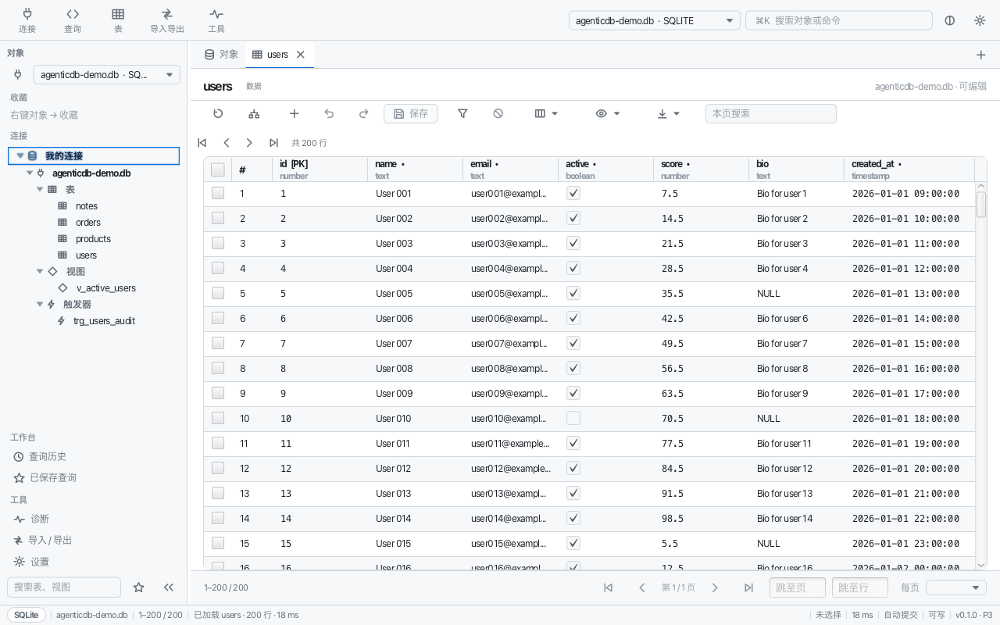
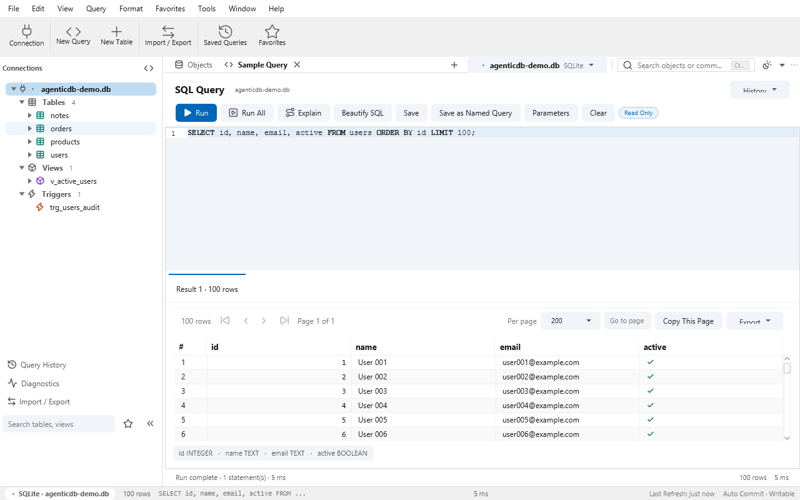

# AIDB — a native desktop database client

**Java 25 + JavaFX 25. No Electron, no embedded WebView, no local HTTP server.**  
One process, one window, every byte to your database over JDBC — and nothing else.

[](LICENSE)
[](https://github.com/jasonchow233-pixel/aidb/actions/workflows/ci.yml)


<p align="center">
  
</p>

## Who it's for

You live in a database all day and want the window in front of you to behave like a desktop application: keyboard-reachable everything, no browser engine holding hundreds of megabytes, no localhost port a firewall or auditor must bless, and no telemetry — apart from the JDBC connection you configured, this app contains no network code.

If you want ER diagrams, notebooks, or an AI copilot, use DBeaver or Chat2DB. This project deliberately does not do those things.

## Databases

| Database | Status |
|---|---|
| **SQLite** | ✅ Supported — file-based, plus a bundled demo database |
| **MySQL** | ✅ 8.x — confirmed against a real server (8.4). 5.7 is dialect-level only |
| **PostgreSQL** | ✅ Confirmed against a real server (16) |
| **MariaDB** | ✅ 10.x / 11.x — confirmed against a real server |
| **SQL Server** | ✅ 2019+ — confirmed against a real server |
| **Oracle** | ✅ 12c+ — confirmed against a real server |
| **Redis** | ✅ Key browsing, five value types, TTL, DEL/FLUSHDB/FLUSHALL; Redis over SSH via a pure-Java tunnel |
| **Object storage** | ✅ One browser for S3-compatible (AWS S3, MinIO, LocalStack), Alibaba Cloud OSS, Qiniu Kodo, Tencent Cloud COS |

## What it looks like to use

<table>
  <tr>
    <td width="50%"><br><b>Edit data in place.</b> Server-side paging, inline Filter & Sort builder, value pickers, up to 3-level sorting, frozen columns, rectangle selection, undo/redo.</td>
    <td width="50%"><br><b>Write SQL, not mouse strokes.</b> Highlighted editor with line numbers, run current statement or all, cancel a running query, multi-statement result tabs, execution plan, error locator, query history, snippets.</td>
  </tr>
  <tr>
    <td width="50%"><br><b>Change structure safely.</b> Add/alter/rename/drop columns, indexes, foreign keys, triggers, CHECK constraints, table comments — preview SQL before execution.</td>
    <td width="50%"><br><b>See the statement before it runs.</b> Every write dialog shows the exact SQL it is about to execute.</td>
  </tr>
</table>

<details>
  <summary>More screenshots</summary>
  <p>Dark theme, cell inspector, find & replace, connection wizard (SSL/SSH), import/export wizards, view designer, object storage browser, and more.</p>
</details>

## Install

**There are no signed, notarized binaries yet.** CI builds unsigned installers on every `v*` tag (`.dmg` / `.msi` / `.deb` via `jpackage`, attached to a draft release). Windows and Linux run unsigned packages without complaint; macOS Gatekeeper blocks an unsigned `.dmg`, so for macOS the supported path is a source build until notarization is wired up.

To run from source:

```bash
git clone https://github.com/jasonchow233-pixel/aidb.git
cd aidb
./scripts/dev.sh          # builds and launches — JDK 25–27, no Maven install needed
```

The first launch creates a demo database (`~/.agenticdb/agenticdb-demo.db`) so there is something real to click on before you point it at your own data. `./scripts/package.sh` produces a `jpackage` app-image / `.dmg` / `.msi` / `.deb` for your platform — it works, it is just unsigned.

## Feature highlights

- **Write safety, three layers.** Every SQL statement is classified by danger before it runs (fail-closed). Write operations preview the exact SQL and require confirmation; the driver re-checks the declared danger level and refuses under-declared danger. A save preview offers one-click undo.
- **Credentials never touch disk.** Passwords go to the OS secure store — macOS Keychain, Windows Credential Manager, Linux Secret Service — and fall back to process memory with a loud warning. `connections.json` keeps non-sensitive fields only.
- **Native desktop, no browser.** JavaFX 25 rendering, no embedded WebView, no local HTTP server, no Electron. One process, one window.
- **Design-token theming.** Light and dark themes, four density levels, 111 design tokens as a single source of truth — a theme switch needs no second icon set.
- **Keyboard-first.** ⌘K / Ctrl+K opens a command palette over every action. Menus, ribbon, toolbar, context menus and the palette are views onto one action registry.

## Why AIDB

| | Stack | Shape | What AIDB does differently |
|---|---|---|---|
| **DBeaver** | Java on Eclipse RCP | Desktop + web | Same language, different premise: one native toolkit, one token system, one action registry — no plugin graph, no driver downloader, no perspectives to learn. |
| **Beekeeper Studio** | Electron / React | Desktop | Modern UI, but a Chromium window. AIDB renders with JavaFX: no bundled browser, no renderer process per window. |
| **Navicat** | Native | Proprietary desktop | Object tree → double-click → data page → edit → save, entirely by keyboard — as a free, auditable Apache-2.0 codebase. |

## Safety model

1. **Classify first, fail closed.** Every statement is graded by danger before it runs. If the grader cannot tell what a statement does, it is treated as dangerous — the default is caution.
2. **Preview and confirm before writing.** Structure edits, routine rebuilds, restores and table transfers show the SQL before execution. DDL transaction support varies by engine; failures can leave partial changes.
3. **Driver-side second opinion.** `DbSession.execute(String, Danger)` re-classifies the statement and refuses under-declared danger — so even programmatic paths that skip UI confirmation are caught.

## Keyboard & accessibility

⌘K / Ctrl+K opens a command palette over every action. Menus, ribbon, toolbar, context menus and the palette are views onto one action registry, so an action disabled in one place is disabled in all of them. Focus walks the shell zones in a documented order, and each page carries a name a screen reader can read aloud.

## Development

```bash
./scripts/build.sh   # compile + full test suite + test-count floor — this is what CI runs
./scripts/dev.sh     # build and launch
./scripts/shots.sh   # regenerate screenshots from current code
./scripts/package.sh # jpackage bundle for the current platform
```

Maven is vendored (`./mvnw`), so there is nothing to install beyond a JDK. Full test baseline: **2153 executed / 0 failed / 133 skipped / 235 test classes**, 16/16 modules (JDK 25, macOS, 2026-11-24).

## Known limits, stated plainly

- **Cold start** historically **5.0–5.6 s** (2026-11-04, macOS, JDK 25, process start → first paint) against a <2 s goal. Lazy connection is WIP; the current startup path has not been re-benchmarked for acceptance.
- **No signed binaries.** Unsigned installers exist; macOS Gatekeeper blocks them. Use a source build on macOS until notarization is available.
- **No auto-update, no jlink runtime image** (RichTextFX / ControlsFX ship as automatic modules).
- **No ER diagrams, no Model ER editor, no job scheduler, no AI assistant** — explicitly out of scope.
- **Object storage:** S3-compatible has real-endpoint evidence; OSS and Kodo have read-only real-account contracts; Tencent COS is compile-and-in-memory only.

## 中文简述

AIDB 是一个**原生桌面数据库客户端**：Java 25 + JavaFX 25，不内嵌浏览器、不启动本地 HTTP 端口，所有数据直接走 JDBC。支持 SQLite / MySQL / PostgreSQL / MariaDB / SQL Server / Oracle，以及 Redis 和对象存储（S3 兼容、阿里云 OSS、七牛 Kodo、腾讯云 COS）。

界面照 Navicat 交互习惯：对象树 → 双击表 → 数据页 → 行内编辑 → 预览 SQL → 单事务保存 → 保存后撤销。全程键盘可达（⌘K 命令面板）。写操作 fail-closed 分级 + 两级确认；口令只进系统钥匙串 / 凭据管理器，明文不落盘。暗亮双主题、四档密度、中英文界面。

目前没有签名/公证过的安装包；macOS 走源码构建。完整文档：[架构](docs/ARCHITECTURE.md) · [路线](docs/ROADMAP.md) · [UI 规格](docs/UI-VISUAL-SPEC.md) · [贡献指南](CONTRIBUTING.md)。

## License · Acknowledgements

Apache-2.0 — see [LICENSE](LICENSE), and [NOTICE](NOTICE) for third-party terms.

Built on [JavaFX](https://openjfx.io/) (GPL-2.0 with Classpath Exception), [RichTextFX](https://github.com/FXMisc/RichTextFX) and [ControlsFX](https://github.com/controlsfx/controlsfx) (BSD), [Jackson](https://github.com/FasterXML/jackson), [Apache POI](https://poi.apache.org/), [JNA](https://github.com/java-native-access/jna) (Apache-2.0), and [Lucide](https://lucide.dev/) icons (ISC).

Report security issues privately: [SECURITY.md](SECURITY.md).
