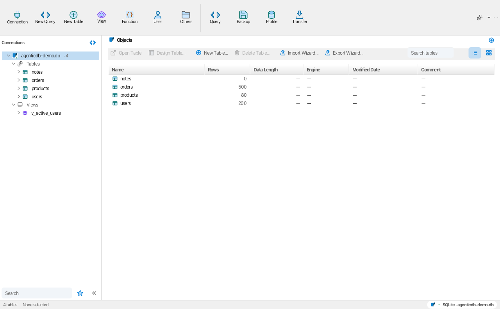
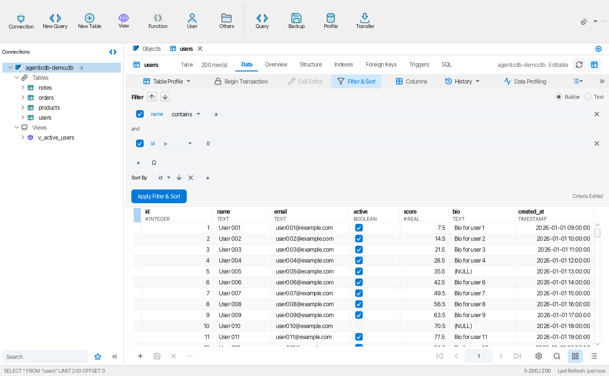
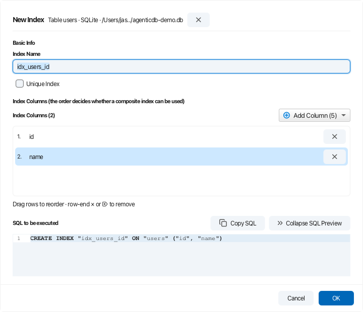

# AIDB — a native desktop database client

**Java 25 + JavaFX 25. No Electron, no embedded WebView, no local HTTP server.**
One process, one window, every byte to your database over JDBC — and nothing else.

[](LICENSE)
[](https://github.com/jasonchow233-pixel/aidb/actions/workflows/ci.yml)


<p align="center">
  
</p>

## Who it's for

You live in a database all day and want the window in front of you to behave like a desktop
application: keyboard-reachable everything, no browser engine holding a few hundred megabytes,
no localhost port a firewall or an auditor has to bless, and no telemetry — because apart from
the JDBC connection you configured, this app contains no network code.

If you want ER diagrams, notebooks, or an AI copilot, use DBeaver or Chat2DB. This project
deliberately does not do those things ([why](#explicitly-not-on-the-roadmap)).

## Databases

| | |
|---|---|
| **SQLite** | ✅ supported — file-based, plus the bundled demo database |
| **MySQL** | ✅ 5.7 and 8.x |
| **PostgreSQL** | ✅ |
| **MariaDB** | 🧪 dialect implemented and unit-gated — not yet run against a real server |
| **SQL Server** | 🧪 dialect implemented and unit-gated — catalog queries not yet verified against a real server |
| **Oracle** | 🧪 dialect implemented and unit-gated (12c+) — catalog queries not yet verified against a real server |

🧪 means the dialect, DDL generation, paging and capability gates are written and covered by unit
tests, but no real server has confirmed the catalog SQL yet. Those paths are marked in the dialect
sources, and the UI hides what a database genuinely cannot express (SQL Server / Oracle explain plans,
SQL Server column comments, Oracle `ON UPDATE`) instead of offering dead controls.

Dialect differences sit behind one `Dialect` abstraction, so introspection, DDL generation and
type mapping behave the same on every server — including where they genuinely cannot, such as
SQLite table comments, which show up **disabled** rather than pretending to work.

## What it looks like to use

<table>
  <tr>
    <td width="50%"><br><b>Edit data in place.</b> Server-side paging, an inline Filter &amp; Sort builder, value pickers on every column header, up to 3-level sorting, frozen columns, rectangle selection, undo / redo.</td>
    <td width="50%"><br><b>Write SQL, not mouse strokes.</b> Highlighted editor with line numbers, run the current statement or all of them, cancel a running query, multi-statement result tabs, execution plan, error locator, query history, snippets.</td>
  </tr>
  <tr>
    <td width="50%"><br><b>Change structure safely.</b> Add / alter / rename / drop columns, indexes, foreign keys, triggers, CHECK constraints and table comments — applied in one transaction, and every open page refreshes with it.</td>
    <td width="50%"><br><b>See the statement before it runs.</b> Every dialog that writes shows the exact SQL it is about to execute, so nothing is explained after the fact.</td>
  </tr>
  <tr>
    <td width="50%"><br><b>Two themes, one source of truth.</b> Light and dark, 107 design tokens, four density levels — and icon colors resolved from those same tokens, so a theme switch needs no second icon set.</td>
    <td width="50%"><br><b>Get data in and out.</b> Streaming CSV / TSV / JSON Lines / SQL / xlsx, field mapping, conversion to the target column's type, and a report that names every bad row.</td>
  </tr>
</table>

## The safety model

Writing to a real database should be boring and strict.

1. **Classify first, fail closed.** Every statement is graded by danger before it runs. If the
   grader cannot tell what a statement does, it is treated as dangerous — the default is caution.
2. **Preview, confirm, one transaction.** Destructive changes need an explicit confirmation;
   structure edits are previewed as SQL and applied in a single transaction, so a failure rolls
   back instead of leaving half a table rebuilt. After a save, one click undoes it.
3. **Not finished: a driver-side second opinion.** `DbSession.execute(sql)` takes no danger
   argument, so a caller that skips the UI layer is not stopped. Two of the three layers exist —
   that is open work, not a claim.

**Credentials never touch disk.** Passwords go to the OS secure store — macOS Keychain, Windows
Credential Manager, Linux Secret Service — and fall back to process memory with a loud warning if
no service is found. `~/.agenticdb/connections.json` keeps the non-sensitive fields only:
`password`, `secret`, `token`, `sslkey` and friends are stripped before writing. No telemetry, no
update pinger, no listening socket.

## Keyboard and accessibility

`⌘K` / `Ctrl+K` opens a command palette over every action. Menus, ribbon, toolbar, context menus
and the palette are views onto one action registry, so an action disabled in one place is disabled
in all of them. Focus walks the six shell zones in a documented order, tab strips and section
switchers are keyboard-operable, and each page carries a name a screen reader can read aloud.
The UI checks assert computed colors and geometry rather than pixels, so they hold at any display
scale and on any platform.

## Install

**There are no prebuilt binaries yet**, and that is not a placeholder I can wave away: a
downloadable build needs an Apple Developer ID and a Windows code-signing certificate, which are
external resources this project does not have. Until then, run it from source:

```bash
git clone https://github.com/jasonchow233-pixel/aidb.git
cd aidb
./scripts/dev.sh          # builds and launches — JDK 25–27, no Maven install needed
```

Add an argument to open straight into a table (`./scripts/dev.sh users`). The first launch creates
a demo database (`~/.agenticdb/agenticdb-demo.db`: four tables, 780 rows, one view, one trigger)
so there is something real to click on before you point it at your own data.
`./scripts/package.sh` produces a `jpackage` app-image / `.dmg` / `.msi` / `.deb` for your platform
— it works, it is just unsigned.

## Why this exists next to DBeaver and Beekeeper

| | Stack | Shape | What AIDB does differently |
|---|---|---|---|
| **DBeaver** | Java on Eclipse RCP | desktop + web | Same language, different premise: one native toolkit, one token system, one action registry — no plugin graph, no driver downloader, no perspectives to learn. |
| **Beekeeper Studio** | Electron / React | desktop | Modern UI, but a Chromium window. AIDB renders with JavaFX: no bundled browser, no renderer process per window. |
| **Navicat** | native | proprietary desktop | The interaction bar to clear. Object tree → double-click → data page → edit → save, entirely by keyboard — as a free, auditable Apache-2.0 codebase. |

## Explicitly not on the roadmap

- **No embedded WebView, no Electron** — native rendering is the reason the project exists.
- **No local HTTP server** — a desktop tool should not need a port.
- **No cloud sync, no multi-user permission system** — single-user desktop, on purpose.
- **No AI assistant as a core dependency** — you write the SQL; local rules enforce safety rather
  than a model's judgment.

## Development

```bash
./scripts/build.sh        # compile + full test suite + test-count floor — this is what CI runs
./scripts/dev.sh          # build and launch
./scripts/shots.sh        # regenerate the screenshots above from current code
./scripts/package.sh      # jpackage bundle for the current platform
```

Maven is vendored (`./mvnw`), so there is nothing to install beyond a JDK.
[CONTRIBUTING.md](CONTRIBUTING.md) covers the environment gotchas, the module map and the rules
every pull request is reviewed against. Design rules are in
[docs/UI-VISUAL-SPEC.md](docs/UI-VISUAL-SPEC.md), structure in
[docs/ARCHITECTURE.md](docs/ARCHITECTURE.md), and what is honest-but-imperfect in
[docs/STATUS.md](docs/STATUS.md).

<details>
<summary><b>More screenshots</b></summary>

<table>
  <tr>
    <td><br>Row inspector</td>
    <td><br>Cell payload as text / JSON / hex / image</td>
  </tr>
  <tr>
    <td><br>Find &amp; replace</td>
    <td><br>Transposed form view</td>
  </tr>
  <tr>
    <td><br>Inline Filter &amp; Sort builder</td>
    <td><br>Connection wizard — SSL writes actual driver properties</td>
  </tr>
  <tr>
    <td><br>Index dialog with live DDL</td>
    <td></td>
  </tr>
</table>

</details>

## Known limits, stated plainly

- Cold start measures **3.5–3.9 s** against a <2 s goal. The floor is JVM + toolkit init and the
  first CSS/layout pass, not application code.
- "Follow system theme" only detects macOS today; Windows and Linux start in light mode.
- Tables without a primary key, and views, are read-only. Undo-after-save covers the last save.
- No auto-update, no code signing, no `jlink` runtime image (RichTextFX / ControlsFX ship as
  automatic modules).
- SSH tunnelling is **not implemented** — the connection wizard says so on that page instead of
  letting you discover it later.
- The full list, with the date every number was measured: [docs/STATUS.md](docs/STATUS.md).

## License · Acknowledgements

Apache-2.0 — see [LICENSE](LICENSE), and [NOTICE](NOTICE) for third-party terms (including
MySQL Connector/J, which is GPL-2.0 with the Universal FOSS Exception).

Built on [JavaFX](https://openjfx.io/) (GPL-2.0 with Classpath Exception),
[RichTextFX](https://github.com/FXMisc/RichTextFX) and [ControlsFX](https://github.com/controlsfx/controlsfx)
(BSD), [HikariCP](https://github.com/brettwooldridge/HikariCP), [Jackson](https://github.com/FasterXML/jackson),
[Apache POI](https://poi.apache.org/), [JNA](https://github.com/java-native-access/jna) (Apache-2.0), and
[Lucide](https://lucide.dev/) icons (ISC — the license text ships next to the assets).

Report security issues privately: [SECURITY.md](SECURITY.md).

---

## 中文简述

AIDB 是一个**原生桌面数据库客户端**：Java 25 + JavaFX 25，不内嵌浏览器、不启动本地 HTTP 端口，
所有数据直接走 JDBC。当前支持 SQLite / MySQL 5.7–8.x / PostgreSQL；MariaDB、SQL Server、Oracle 的方言
已实现并有单测门禁（🧪），但**尚未在真库上验证过**，目录查询在方言源码里逐条标注了这一点。

界面照 Navicat 的交互习惯做：对象树 → 双击表 → 数据页 → 行内编辑 → 预览 SQL → 单事务保存 → 保存后撤销，
全程键盘可达（⌘K 命令面板）。写操作 fail-closed 分级 + 两级确认；口令只进系统钥匙串 / 凭据管理器，明文不落盘。
暗亮双主题、108 个设计令牌单一真相、四档密度、中英文界面。

**目前没有可下载的安装包**（缺 Apple 公证与 Windows 代码签名证书），只能源码运行：`./scripts/dev.sh`。
冷启动实测 3.5–3.9 秒，未达 <2 秒目标 —— 这些写在 [docs/STATUS.md](docs/STATUS.md) 里，不藏在截图后面。

完整文档：[对外路线](docs/ROADMAP.md) · [架构](docs/ARCHITECTURE.md) · [UI 规格](docs/UI-VISUAL-SPEC.md) ·
[组件选型与许可](docs/COMPONENT-SELECTION.md) · [贡献指南](CONTRIBUTING.md)。
