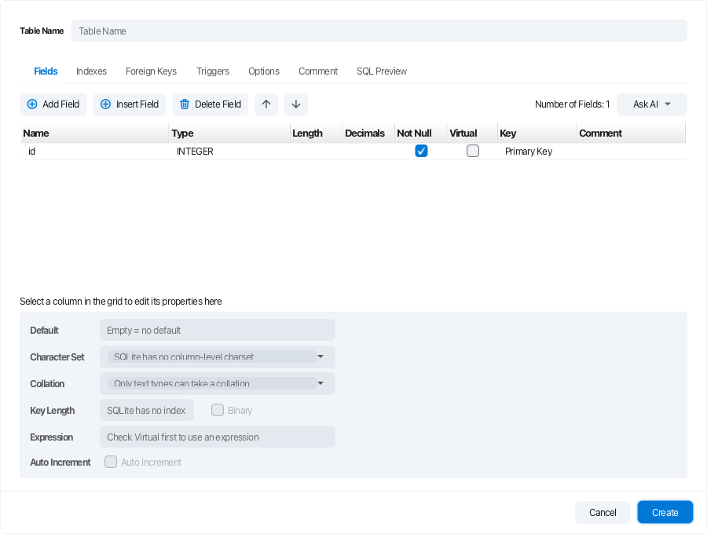
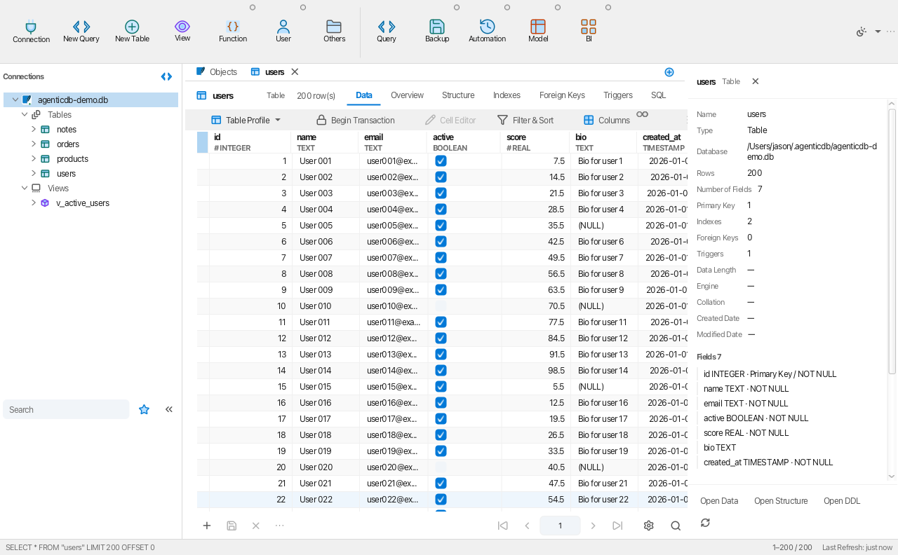
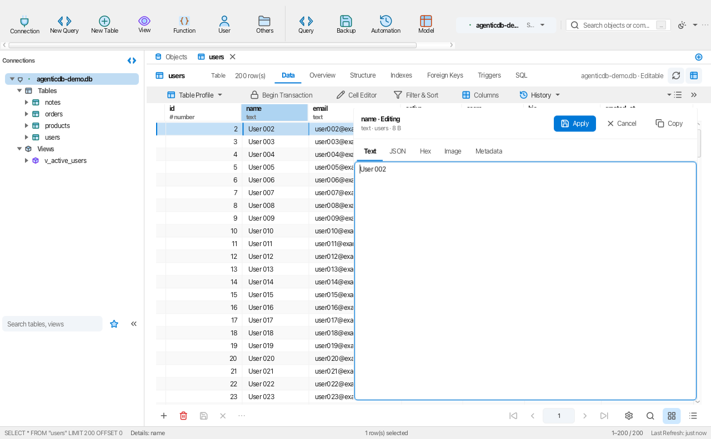
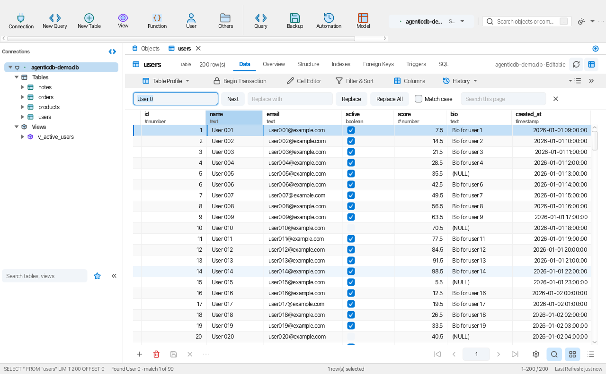
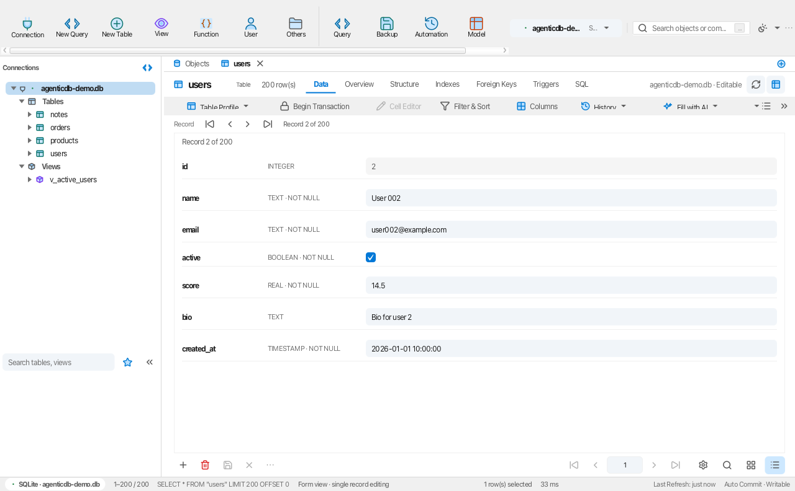
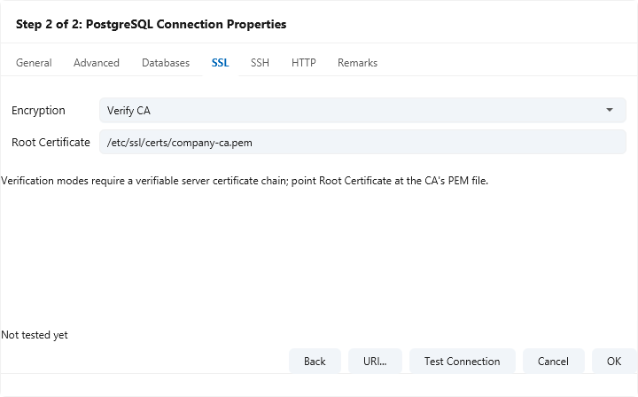
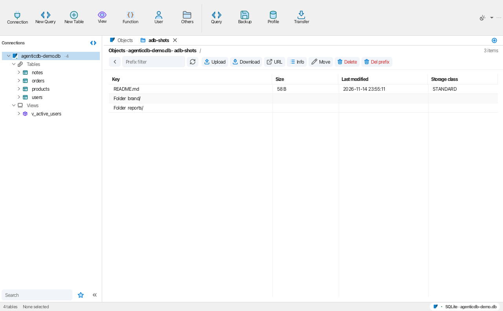

# AIDB — a native desktop database client

**Java 25 + JavaFX 25. No Electron, no embedded WebView, no local HTTP server.**
One process, one window, every byte to your database over JDBC — and nothing else.

[](LICENSE)
[](https://github.com/jasonchow233-pixel/aidb/actions/workflows/ci.yml)


<p align="center">
  
</p>

## Who it's for

You live in a database all day and want the window in front of you to behave like a desktop
application: keyboard-reachable everything, no browser engine holding a few hundred megabytes,
no localhost port a firewall or an auditor has to bless, and no telemetry — because apart from
the JDBC connection you configured, this app contains no network code.

If you want ER diagrams, notebooks, or an AI copilot, use DBeaver or Chat2DB. This project
deliberately does not do those things ([why](#explicitly-not-on-the-roadmap)).

## Databases

| | |
|---|---|
| **SQLite** | ✅ supported — file-based, plus the bundled demo database |
| **MySQL** | ✅ 8.x — catalog SQL, DDL, views and catalog switching confirmed against a real server (8.4). 5.7 is covered at dialect level only: the version matrix that would prove it is opt-in and has never been run here |
| **PostgreSQL** | ✅ — catalog SQL, DDL, views and catalog switching confirmed against a real server (16) |
| **MariaDB** | ✅ 10.x / 11.x — catalog SQL and DDL confirmed against a real server |
| **SQL Server** | ✅ 2019+ — `sys.*` catalog queries confirmed against a real server |
| **Oracle** | ✅ 12c+ — `ALL_*` catalog queries and `DBMS_METADATA` confirmed against a real server |
| **Redis** | ✅ key browsing (`SCAN`, type, TTL, size), value view/edit for five types, TTL and `DEL` / `FLUSHDB` / `FLUSHALL` behind the shared destructive-confirm gate. ⚠️ Redis over SSH is not wired up yet |
| **Object storage** | ✅ one browser for four providers: S3-compatible endpoints (AWS S3, MinIO, LocalStack), Alibaba Cloud OSS, Qiniu Kodo and Tencent Cloud COS. Prefix navigation, upload / download, single-object and recursive-prefix delete, metadata, presigned URLs and move/rename. Credentials live in the system credential store, never in `connections.json`. ⭐ The S3-compatible branch has a real LocalStack endpoint contract + a matching UI frame, and Alibaba Cloud OSS has a real-account read-only contract (credentials from environment variables only, no writes by default); Kodo / COS are compile-and-in-memory only — see Limitations |

✅ for the last three means the dialect, DDL generation, paging and capability gates are covered by
unit tests **and** executed against real servers in the Docker matrix (`scripts/dbmatrix.sh`, opt-in
via environment variables). That matrix is what caught D-20/D-22/D-24/D-25 — four defects that only a
real server reports — and, once the view lifecycle became contract #8, D-27/D-29 as well: reading a
SQL Server view definition was a stub that always returned "nothing found", and MySQL was assumed to
lack `CREATE OR REPLACE VIEW` (it does not), which made us drop-and-recreate a view that one statement
could have replaced. Contract #9 then asked a question no unit test had answered — the query page's
database picker proves it rebinds the session, but nothing had ever run a statement against the second
database to see where it landed. It now does, on two same-host databases per engine, using one table
name and byte-identical SQL on both sides. Encryption got its own tier the same way: `scripts/dbmatrix.sh tls-up`
brings up MySQL, MariaDB and PostgreSQL behind a self-signed CA — and a second, unrelated CA — so
3 × 6 contracts can ask whether "no encryption" really leaves the session in plaintext, whether
"require" really encrypts it, whether handing over the issuing CA makes chain verification pass while
a rogue CA is rejected, and whether a hostname that is not written in the certificate is refused.
That caught D-33 (choosing "no encryption" wrote no parameter at all, and all three drivers encrypt
when the connection string says nothing — the label was lying), D-32 (a certificate failure was
reported as "connection lost", so the advice sent users off to check their network) and D-34 (a
connection that never came up was reported as a query timeout). Where a driver genuinely cannot
express something, the field is disabled and the hint says what to do instead of offering a control
that silently does nothing: Connector/J 8.2 has no CA-file option — neither `sslCA` nor `sslCapath`,
and unknown properties are ignored without a warning — so the Root Certificate box is greyed out for
MySQL and the hint points at `trustCertificateKeyStoreUrl`. The UI also hides what a database
genuinely cannot express (SQL Server / Oracle explain plans, SQL Server column comments,
Oracle `ON UPDATE`) instead of offering dead controls.

Dialect differences sit behind one `Dialect` abstraction, so introspection, DDL generation and
type mapping behave the same on every server — including where they genuinely cannot, such as
SQLite table comments, which show up **disabled** rather than pretending to work.

Connection types are registered in one place (`AssetFamilyRegistry`): adding a family registers its
tiles, wizard steps and tree behaviour, rather than threading a new `if` through the UI. Redis and
object storage use the same write-safety model as SQL — every mutating operation is classified
(`READ_ONLY` / `MUTATING` / `DESTRUCTIVE` / `ADMIN`, unknown operations fail closed to the highest
level) and destructive ones go through a confirmation dialogue whose default button is *Cancel*.

Object storage has no real directories. The browser folds keys containing `/` into virtual folder
rows using a delimiter, and flattens the listing when it needs to delete a prefix recursively.
Capabilities are declared per provider instead of guessed: Qiniu Kodo has no server-side move and
cannot list buckets, so **Move / rename is disabled with a tooltip that says why** (and the backend
throws `UnsupportedOperationException`), and the tree shows only the configured bucket. No control
is left in place that silently does nothing.

## What it looks like to use

The server results above and screenshots below are historical evidence, not acceptance of the current
P0 work in progress. Current verification limits are recorded in [STATUS](docs/STATUS.md).

<table>
  <tr>
    <td width="50%"><br><b>Edit data in place.</b> Server-side paging, an inline Filter &amp; Sort builder, value pickers on every column header, up to 3-level sorting, frozen columns, rectangle selection, undo / redo.</td>
    <td width="50%"><br><b>Write SQL, not mouse strokes.</b> Highlighted editor with line numbers, run the current statement or all of them, cancel a running query, multi-statement result tabs, execution plan, error locator, query history, snippets.</td>
  </tr>
  <tr>
    <td width="50%"><br><b>Change structure safely.</b> Add / alter / rename / drop columns, indexes, foreign keys, triggers, CHECK constraints and table comments — preview SQL before execution, then refresh affected pages. DDL rollback depends on the engine; atomic changes are not guaranteed across dialects. Views have a designer dialog for create / redesign / drop.</td>
    <td width="50%"><br><b>See the statement before it runs.</b> Every dialog that writes shows the exact SQL it is about to execute, so nothing is explained after the fact.</td>
  </tr>
  <tr>
    <td width="50%"><br><b>Two themes, one source of truth.</b> Light and dark, 107 design tokens, four density levels — and icon colors resolved from those same tokens, so a theme switch needs no second icon set.</td>
    <td width="50%"><br><b>Get data in and out.</b> Streaming CSV / TSV / JSON Lines / SQL / xlsx, field mapping, conversion to the target column's type, and a report that names every bad row.</td>
  </tr>
</table>

## The safety model

Writing to a real database should be boring and strict.

1. **Classify first, fail closed.** Every statement is graded by danger before it runs. If the
   grader cannot tell what a statement does, it is treated as dangerous — the default is caution.
2. **Preview and confirm before writing.** Structure edits, routine rebuilds, restores and table
   transfers show the SQL before execution. DDL transaction support varies by engine: some commands
   commit implicitly and failures can leave partial changes. Existing transactions remain the user's
   responsibility; SQLite table rebuilds require a separate transaction.
3. **A driver-side second opinion.** `DbSession.execute(String, Danger)` re-classifies the statement
   via `requireDeclared` and refuses under-declared danger. This is not user authorization: callers
   must still preview and confirm writes. Bare JDBC operations and convenience overloads do not prove
   complete UI confirmation coverage; the current audit and verification limits are in [STATUS](docs/STATUS.md).

**Credentials never touch disk.** Passwords go to the OS secure store — macOS Keychain, Windows
Credential Manager, Linux Secret Service — and fall back to process memory with a loud warning if
no service is found. `~/.agenticdb/connections.json` keeps the non-sensitive fields only:
`password`, `secret`, `token`, `sslkey` and friends are stripped before writing. No telemetry, no
update pinger, no listening socket.

## Keyboard and accessibility

`⌘K` / `Ctrl+K` opens a command palette over every action. Menus, ribbon, toolbar, context menus
and the palette are views onto one action registry, so an action disabled in one place is disabled
in all of them. Focus walks the six shell zones in a documented order, tab strips and section
switchers are keyboard-operable, and each page carries a name a screen reader can read aloud.
The UI checks assert computed colors and geometry rather than pixels, so they hold at any display
scale and on any platform.

## Install

**There are no signed, notarized binaries yet**, and that is not a placeholder I can wave away: a
trustworthy download needs an Apple Developer ID (for macOS notarization) and a Windows code-signing
certificate, which are external resources this project does not have. **CI still builds installers** —
pushing a `v*` tag runs `.github/workflows/release.yml`, which produces an unsigned `.dmg` / `.msi` /
`.deb` via `jpackage` and attaches them to a draft release. Windows and Linux run those unsigned
packages without complaint; macOS gatekeeper blocks an unsigned `.dmg`, so for macOS the supported path
is a source build (`./scripts/dev.sh` or `./scripts/package.sh`) until notarization is wired up. Until
then, to run it from source:

```bash
git clone https://github.com/jasonchow233-pixel/aidb.git
cd aidb
./scripts/dev.sh          # builds and launches — JDK 25–27, no Maven install needed
```

Add an argument to open straight into a table (`./scripts/dev.sh users`). The first launch creates
a demo database (`~/.agenticdb/agenticdb-demo.db`: four tables, 780 rows, one view, one trigger)
so there is something real to click on before you point it at your own data.
`./scripts/package.sh` produces a `jpackage` app-image / `.dmg` / `.msi` / `.deb` for your platform
— it works, it is just unsigned.

## Why this exists next to DBeaver and Beekeeper

| | Stack | Shape | What AIDB does differently |
|---|---|---|---|
| **DBeaver** | Java on Eclipse RCP | desktop + web | Same language, different premise: one native toolkit, one token system, one action registry — no plugin graph, no driver downloader, no perspectives to learn. |
| **Beekeeper Studio** | Electron / React | desktop | Modern UI, but a Chromium window. AIDB renders with JavaFX: no bundled browser, no renderer process per window. |
| **Navicat** | native | proprietary desktop | The interaction bar to clear. Object tree → double-click → data page → edit → save, entirely by keyboard — as a free, auditable Apache-2.0 codebase. |

## Explicitly not on the roadmap

- **No embedded WebView, no Electron** — native rendering is the reason the project exists.
- **No local HTTP server** — a desktop tool should not need a port.
- **No cloud sync, no multi-user permission system** — single-user desktop, on purpose.
- **No AI assistant as a core dependency** — you write the SQL; local rules enforce safety rather
  than a model's judgment.
- **No ER diagrams, no Model ER editor** — not even a read-only structure diagram; explicitly ruled
  out on 2026-11-10, with the entries removed from the product rather than left as notice pages.

## Development

```bash
./scripts/build.sh        # compile + full test suite + test-count floor — this is what CI runs
./scripts/dev.sh          # build and launch
./scripts/shots.sh        # regenerate the screenshots above from current code
./scripts/package.sh      # jpackage bundle for the current platform
```

Maven is vendored (`./mvnw`), so there is nothing to install beyond a JDK.

**Toolchain:** `scripts/_env.sh` reads the enforcer range straight from `pom.xml` (`[25,28)`) and
auto-selects a matching JDK before every build/screenshot script. Priority: an explicit, valid
`JAVA_HOME` (never overridden) → `$HOME/.workbuddy/jdk/*` (a user-level install that survives
reboots and `/tmp` cleanup) → a JDK registered with macOS `java_home`. Only the script's own
`JAVA_HOME`/`PATH` are exported; the system default `java` is untouched. On a machine whose default
JDK is still 11 or 17, drop a Temurin 25 bundle into `$HOME/.workbuddy/jdk/` and the scripts just work —
no per-shell `export JAVA_HOME` needed. Set `ADB_JDK_DIR` to point somewhere else.

[CONTRIBUTING.md](CONTRIBUTING.md) covers the environment gotchas, the module map and the rules
every pull request is reviewed against. Design rules are in
[docs/UI-VISUAL-SPEC.md](docs/UI-VISUAL-SPEC.md), structure in
[docs/ARCHITECTURE.md](docs/ARCHITECTURE.md), and what is honest-but-imperfect in
[docs/STATUS.md](docs/STATUS.md).

<details>
<summary><b>More screenshots</b></summary>

<table>
  <tr>
    <td><br>Row inspector</td>
    <td><br>Cell payload as text / JSON / hex / image</td>
  </tr>
  <tr>
    <td><br>Find &amp; replace</td>
    <td><br>Transposed form view</td>
  </tr>
  <tr>
    <td><br>Inline Filter &amp; Sort builder</td>
    <td><br>Connection wizard — SSL writes actual driver properties</td>
  </tr>
  <tr>
    <td><br>Index dialog with live DDL</td>
    <td><br>Object browser against a real S3 endpoint</td>
  </tr>
</table>

</details>

## Known limits, stated plainly

- Historical cold start measured **5.0–5.6 s** (2026-11-04, worst of three, `./scripts/startup-bench.sh`, process start → first paint)
  against a <2 s goal. The floor is JVM + toolkit init and the first CSS/layout pass (1.6 s), not application
  code; R61 moved the first SQLite driver load (762 ms) off the pre-paint path, which bought ~344 ms on average.
  ⚠️ The **3.5–3.9 s** this file used to quote was measured on a different machine (Windows 10, JDK 27, 2026-10-26)
  and its doc line doesn't record which of `StartupTrace`'s two numbers it read — so the two are not comparable,
  and 5.0–5.6 s remains a historical figure. Lazy initial connection is now WIP in `AppShell`;
  the current startup path has not been benchmarked for acceptance.
- "Follow system theme" has macOS, Windows registry and Linux GNOME/KDE detection paths.
  Windows/Linux detection has not been verified on real desktops; failed detection falls back to light mode.
- Tables without a primary key, and views, are read-only **in the data grid** — a view's
  *definition* is editable: create, redesign and drop views from the object tree or the View
  ribbon tile, with the same live SQL preview as the table designer. Undo-after-save covers the
  last save.
- **No job scheduler, no ER diagrams (not even a read-only structure diagram), no Model ER editor.**
  These Navicat surfaces are out of scope by explicit decision: Automation (job scheduling), the
  Model ER editor and ER-diagram views were **removed from the product on 2026-11-10** (the Ribbon
  tiles / toolbar entries are gone, not replaced with notice pages).
- No auto-update, no code signing, no `jlink` runtime image (RichTextFX / ControlsFX ship as
  automatic modules).
- SSH tunnelling **is implemented** — a pure-Java tunnel (Apache MINA `sshd-core`, no system
  `ssh` binary) with OpenSSH `known_hosts` host keys and a TOFU fingerprint prompt; the connection
  wizard's SSH page is a real form. Only RSA / ECDSA private keys are supported (ed25519 is not),
  which the wizard states next to the field.
- **Object storage: S3-compatible and Alibaba Cloud OSS have real-endpoint evidence; the two
  remaining native SDK adapters do not.** `S3RealEndpointContractTest` runs 10 cases against a real
  `localstack/localstack:4.9.2` container over a trusted HTTPS endpoint — bucket listing,
  put/get/metadata, delimiter folding, **1001 objects across the ListObjectsV2 page boundary**,
  single-object and recursive-prefix delete, move with MIME preservation, and a presigned URL
  fetched with a real HTTP GET. All cases go through the product's own
  `ObjectStoreSessions.connect` factory. `p10-object-store-real.png` is the matching UI frame.
  `OssRealEndpointContractTest` adds 8 opt-in cases against a real Alibaba Cloud OSS account
  (bucket listing, marker paging across the 1000-object boundary checked against the native SDK,
  metadata, and a presigned URL fetched over real HTTPS); credentials are read only from
  `ADB_TEST_OSS_*` environment variables, the suite is read-only by default and no credential
  literal is stored in the repository. Qiniu Kodo and Tencent COS still have only compile-time SDK
  types plus the in-memory contract suite, so "all four providers connect" is not a claim this
  project makes. The browser still lists a whole delimiter level in one call — measured on a
  bucket with over 12,000 objects — so there is no progressive pagination for very large buckets.
  ⚠️ A plain `http://` S3-compatible endpoint is not supported yet: AWS SDK 2.31 sends
  `Expect: 100-continue` with streaming SigV4 and some gateways never answer it, so uploads stall
  until read timeout. Use an HTTPS endpoint.
  **Redis** has 14 contract cases on a real `redis:7.2` testcontainers instance (including a real
  FLUSHALL mutation check) and a matching frame shot against that container.
- **Redis over SSH is not wired up**: `RedisSessions` states this in code. SQL connections still
  support the pure-Java SSH tunnel; Redis connections currently go direct.
- **Five new brand marks are neutral geometric placeholders** (`redis`, `aws-s3`, `aliyun-oss`,
  `qiniu`, `tencent-cos`). `TRADEMARK-NOTICE.txt` names each one; official vector assets must
  replace them before any public release.
- The first-run welcome overlay, the wizard's family filter, the object browser, the tabs
  overview, the Redis key browser and a real-endpoint object browser each have a matching frame
  in `docs/screenshots/` (74 frames, no duplicate hashes). The offline `p10-object-browser.png`
  frame is kept as a shell/interaction reference; `p10-object-store-real.png` is the one backed
  by an actual S3 server.
- The full list, with the date every number was measured: [docs/STATUS.md](docs/STATUS.md).

## License · Acknowledgements

Apache-2.0 — see [LICENSE](LICENSE), and [NOTICE](NOTICE) for third-party terms (including
MySQL Connector/J, which is GPL-2.0 with the Universal FOSS Exception).

Built on [JavaFX](https://openjfx.io/) (GPL-2.0 with Classpath Exception),
[RichTextFX](https://github.com/FXMisc/RichTextFX) and [ControlsFX](https://github.com/controlsfx/controlsfx)
(BSD), [Jackson](https://github.com/FasterXML/jackson),
[Apache POI](https://poi.apache.org/), [JNA](https://github.com/java-native-access/jna) (Apache-2.0), and
[Lucide](https://lucide.dev/) icons (ISC — the license text ships next to the assets).

Report security issues privately: [SECURITY.md](SECURITY.md).

---

## 中文简述

AIDB 是一个**原生桌面数据库客户端**：Java 25 + JavaFX 25，不内嵌浏览器、不启动本地 HTTP 端口，
所有数据直接走 JDBC。当前支持 SQLite / MySQL / PostgreSQL / MariaDB / SQL Server / Oracle ——
后三种原先只有方言与单测门禁，R46 起进了本机 Docker 真库矩阵，目录查询与 DDL 契约逐条实跑，
当场抓出四条只有真服务器才会报的缺陷（D-20 / D-22 / D-24 / D-25）；R52 把视图生命周期补成契约第 8 条，
又抓出两条 —— SQL Server 读视图定义是个永远返回「读不到」的空壳（「设计视图」因此在那个库上从来没开过窗），
MySQL 被当成没有 `CREATE OR REPLACE VIEW`（其实有），于是把一句就能完成的改视图做成了「先删再建」两句；
第 9 条「切库落点与隔离」问的是单测一直没答的问题：查询页那颗库选择器只验过「连接对象换了库名」，
**没人把语句真交给绑到新库的会话看过它落在哪儿** —— 现在是每家两把同机库、同一个表名、字面相同的 SQL，两边各读各的行。
⚠️ MySQL 5.7 目前只有方言层的承诺：能证明它的版本矩阵是 opt-in，本机从没跑过（8.x 有执行证据）。
TLS 那一层单起了第二圈对端：`scripts/dbmatrix.sh tls-up` 用一把自签 CA + 一把冒名 CA 把
MySQL / MariaDB / PostgreSQL 各跑一个加密服务，三家 × 6 条契约问的是「选了不加密是否真的明文」
「require 是否真把会话加密起来」「给了签发方是否真通过、换一把没签过服务器的 CA 是否真被拒」
「证书里没写的那个名字是否真被挡」。这一跑抓出三条：D-33（选「不加密」时一个参数都不写，
而三家驱动的默认都是「能加密就加密」—— 那个标签一直在骗人）、D-32（证书失败被归成「连接已断开」，
建议把人支去查网络）、D-34（连接根本没建起来被归成「查询超时」）。

界面照 Navicat 的交互习惯做：对象树 → 双击表 → 数据页 → 行内编辑 → 预览 SQL → 单事务保存 → 保存后撤销，
视图同样在这棵树上建 / 改 / 删（设计器弹窗，预览几句就跑几句）。
全程键盘可达（⌘K 命令面板）。写操作 fail-closed 分级 + 两级确认；口令只进系统钥匙串 / 凭据管理器，明文不落盘。
暗亮双主题、104 个设计令牌单一真相、四档密度、中英文界面。

**目前没有「签名 / 公证」过的安装包**：缺 Apple 公证与 Windows 代码签名证书。但 CI 已能出包——推送 `v*` tag 会跑 `.github/workflows/release.yml`，用 `jpackage` 产出**未签名**的 `.dmg` / `.msi` / `.deb` 并挂到草稿发布；Windows / Linux 能直接跑未签名包，macOS 的 gatekeeper 会拦未签名 `.dmg`，所以 macOS 仍走源码构建（`./scripts/dev.sh` 或 `./scripts/package.sh`），等公证接上再放开。眼下最稳的体验仍是源码运行：`./scripts/dev.sh`。
历史冷启动实测 **5.0–5.6 秒**（2026-11-04，本机 macOS 15.7.9 + JDK 25，三次取最坏，口径「进程启动 → 首屏」），当时未达 <2 秒目标；当前 `AppShell` 懒连接已在 WIP，尚未完成新路径启动验收。
旧文档那句「3.5–3.9 秒」量于另一台机器（Windows 10 + JDK 27）且没记读的是哪个数，不可比，已作废。
这些都写在 [docs/STATUS.md](docs/STATUS.md) 里，不藏在截图后面。

完整文档：[对外路线](docs/ROADMAP.md) · [架构](docs/ARCHITECTURE.md) · [UI 规格](docs/UI-VISUAL-SPEC.md) ·
[组件选型与许可](docs/COMPONENT-SELECTION.md) · [贡献指南](CONTRIBUTING.md)。
