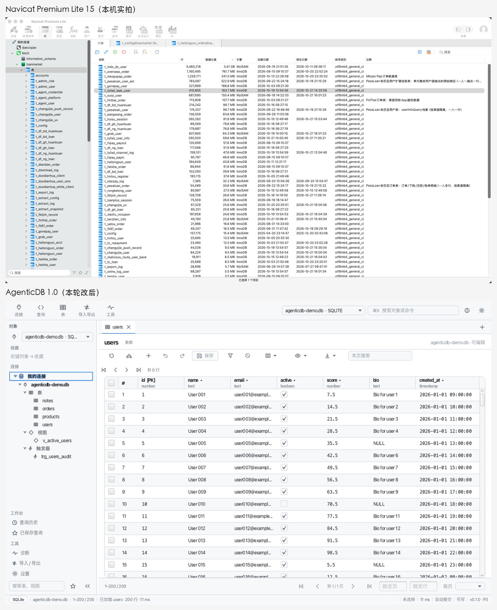

# NAVICAT-COMPARE — 与 Navicat 的**实拍**对比

> 本文里的 Navicat 截图是**本机实拍**（`/Applications/Navicat Premium Lite.app`，
> 版本 15，macOS），不是凭印象描述的。
>
> 对照物：AgenticDB 1.0（第五轮改后）
> 拍摄日期：**2026-10-21**
>
> 原图：`docs/screenshots/navicat/navicat-tablelist.png`（整窗）、
> `navicat-toolbar.png`（工具栏特写）、`side-by-side.png`（并排）

---

## 0. 怎么拍的（可复现）

```bash
open -a "Navicat Premium Lite"
sleep 12
# 找窗口 id（Navicat 的窗口在第二块屏幕上）
python3 - <<'PY'
import Quartz
wl = Quartz.CGWindowListCopyWindowInfo(
    Quartz.kCGWindowListOptionOnScreenOnly | Quartz.kCGWindowListExcludeDesktopElements,
    Quartz.kCGNullWindowID)
for w in wl:
    if 'avica' in w.get('kCGWindowOwnerName', ''):
        print(w.get('kCGWindowNumber'))
PY
screencapture -x -o -l<窗口id> navicat.png
```

> ⚠️ `osascript` 的「辅助访问」在本机被拒（`-1719`），
> 所以拿不到窗口坐标；`CGWindowListCopyWindowInfo` 不需要这个权限 ✓。

---

## 1. 并排看



---

## 2. 逐项对比

### 2.1 ✅ 已经对上的

| 项 | Navicat（实拍） | AgenticDB | 备注 |
|---|---|---|---|
| **顶栏形态** | 大图标在上、文字在下 | 同形 | 第五轮把 Unicode 符号换成了 38 个矢量图标，**字形不再随系统字体变** |
| **侧栏底部** | 搜索框 + ★ + 折叠/过滤钮 | 搜索框 + ★ + « | — |
| **标签栏** | 图标 + 名称 + ✕ | 同形 | Navicat 的标签图标是**蓝色实心**小表形；我们是描边矢量 |
| **数据页工具栏** | **纯图标条**（无文字） | 纯图标条 | ⭐ 本轮刚改成 Navicat 形态（原来 11 个「图标+文字」把工具栏撑爆，文字被压成「…」） |
| **对象树** | 连接 → 库 → 表 | 连接 → 表/视图/过程/函数/触发器 → 对象 | Navicat **Lite** 是平铺；**Premium 才是分组** —— 我们对标的是 Premium ✓ |
| **列头** | 列名 + 排序箭头 + 类型 | 同形 | — |
| **斑马纹** | 无 | 无 | 一致 |
| **状态栏** | 连接 / 选中项 | 连接 / 行数 / 耗时 / 事务 | 我们多 |

### 2.2 🔴 还没对上的（**实拍暴露的真差距**）

| # | 项 | Navicat（实拍） | AgenticDB | 影响 | 处置 |
|---|---|---|---|---|---|
| **C1** | **「对象」首页标签** | 标签栏最左边有一个**常驻的「对象」标签**（不可关闭） | **没有** | 🔴 高 —— Navicat 的第一入口就是它 | **S5 提为 P1**，实拍证实了这项需求（见 `NAVICAT-TODO.md` §6.4 S5） |
| **C2** | **工具栏右侧的视图模式切换** | 两个小钮（网格视图 / 列表视图）+ 搜索框 | 只有搜索框 | 🟡 中 | 列入 U-B6（视图模式切换） |
| **C3** | **表清单的列** | **8 列**：名称 / 行 / 数据长度 / 引擎 / 创建日期 / **修改日期** / **排序规则** / **注释** | **5 列**：名称 / 行数 / 数据长度 / 引擎 / 创建日期 | 🟡 中 | 缺 3 列。`修改日期` 要各方言的元信息支持；`排序规则`/`注释` 可从内省补 |
| **C4** | **行高** | ~22px（很密，一屏 40+ 行） | 32px 标准 / 26px 紧凑 | 🟡 中 | 我们更宽松。密度档位已能覆盖，但**默认值**可以更密 —— 属产品决策 |
| **C5** | **图标语义色** | 编辑=蓝、新增=绿、删除=红、撤销/重做=橙 | 基本全灰 | 🟢 低 | 本轮已给**删除**补上危险色（红）；其余保持单色 —— 单色是更现代的做法，**不追** |
| **C6** | **顶栏功能数** | 11 个（连接/新建查询/表/视图/函数/用户/其它/查询/自动同步/备份/模型/分割） | 5 个（连接/查询/表/导入导出/工具） | 🟢 低 | 我们的 5 个覆盖了首版范围；其余是 P5/P6 的功能，**随功能走** |

### 2.3 我们**更好**的地方（不必改）

| 项 | 说明 |
|---|---|
| **危险色体系** | Navicat 没有「风险四级」的概念（只读/写入/结构/管理）。我们有四级风险色 + 徽标 + 逐级确认 ✅ |
| **危险门禁三层** | 分类 fail-closed + UI 二次确认 + **驱动侧复查** —— Navicat 没有第三层 ✅ |
| **密度三档** | Navicat Lite 没有密度切换 ✅ |
| **暗色主题** | Navicat Premium 有；Lite 没有。我们两套都有且令牌一一对应 ✅ |
| **真库联调** | Navicat 闭源无从验证；我们有 SQLite + MySQL 5.7 的真库契约 ✅ |

---

## 3. 实拍带来的两个**具体**改动

### 3.1 工具栏从「图标+文字」改成**纯图标条**

加图标之后截图里工具栏的文字被压成「…」，根因是
**11 个「图标+文字」按钮的总宽超过了可用宽度**。
解法不是把图标画小，而是改成 Navicat 的形态：**纯图标 + Tooltip + accessibleText**。

```
改前：↻ 刷新  ☰ 结构  ＋ 新增  ↶ 撤销  ↷ 重做  ▽ 筛选  清除条件  ▦ 列  ▤ 视图  ⤓ 导出
      └────────── 11 个带文字的按钮 ──────────┘        （挤爆 → 文字变「…」）

改后：↻  ⛁  ＋  ↶  ↷  [💾保存]  ▽  ⊘  ▥▾  👁▾  ⤓▾     （纯图标条，宽裕）
```

> ⚠️ 但**保存**保留「图标 + 文字」——
> 它是这一行的**主操作**，有文字才看得出层级。

### 3.2 删除图标改成**危险色**

实拍里 Navicat 的删除图标是红的。我们原来全灰，
会出现「红色的『删除』文字 + 灰色的垃圾桶图标」这种自相矛盾。
已加 `.adb-button--danger .adb-icon { -fx-stroke: -adb-error; }`。

---

## 4. 下一步（按实拍结论重排优先级）

| 优先 | 项 | 依据 |
|---|---|---|
| ~~P0~~ ✅ | ~~S5「对象」首页标签~~ | **实拍 C1** —— **已关闭**（见 §2.2 C1） |
| **P1** | **U-B6**：G2 列拖拽 · G1 冻结列 · G4 区域选择 · G6 自增列 · Q5 结果分页 · U1 catalog 树 · U2 多连接并行 · U3 连接属性页 · U4 索引可编辑 | 功能差距 |
| **P1** | **C3 表清单补列**（修改日期 / 排序规则 / 注释） | 实拍 C3 |
| **P2** | **C2 视图模式切换**（网格 / 列表） | 实拍 C2 |
| **P2** | **C4 默认行高更密**（32 → 26 起步） | 实拍 C4；属产品决策 |
| **P3** | C5 图标语义色 | 实拍 C5 —— **不追**（单色更现代） |
| **P3** | C6 顶栏功能数 | 随 P5/P6 功能走 |

---

## 5. 诚实声明

- Navicat 的截图是 **Navicat Premium Lite 15**，不是 Premium —— 顶栏功能数（11 个）
  与对象树形态（平铺而非分组）在两个版本间**不同**。
  本文的对比基准是 **Premium 的信息架构**（分组对象树、大图标功能栏），
  截图取自 Lite（手上只有这个）。
- 「AgenticDB」一侧是**本轮改后**的实拍（`docs/screenshots/*.png`，与本仓库代码同一份）。
- 本轮的比对是**逐项人工看图**得出的，不是像素级 diff —— 像素级 diff 需要同一台机器
  上装两个版本的 Navicat 才做得了。
